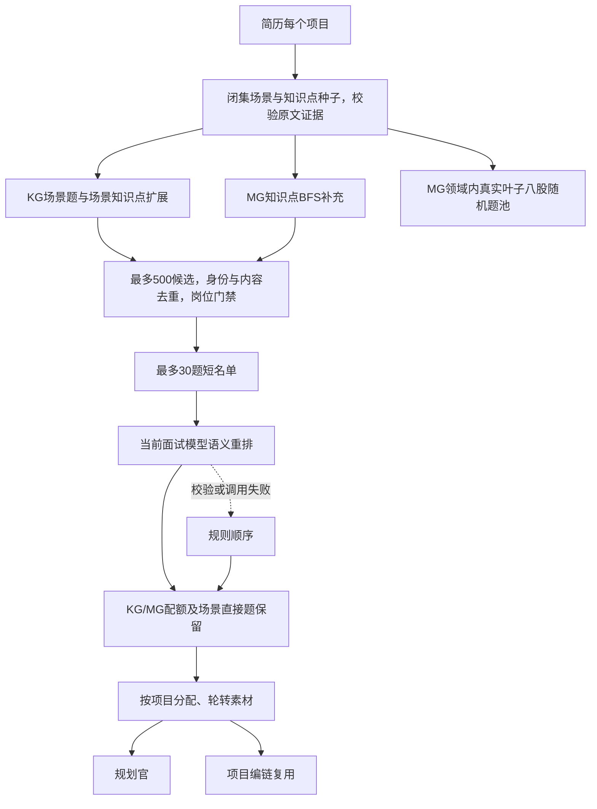

# MG/KG主链路接入记录

日期：2026-11-06。

## 已记录的评测结论

完整报告见[四组检索与LLM重排评测](MG-KG四组检索与LLM重排评测-2026-11-06.md)。使用9,000条处理记录、8,704道题的固定图，24个需求、2个随机种子，共192次方法运行；评审不看来源方法、标签、路径和排序。

| 方法 | 直接相关P@10 | 至少辅助相关P@10 |
| --- | ---: | ---: |
| 原始标签评分组件 | 36.0% | 74.2% |
| AI细标签平铺 | 65.2% | 88.8% |
| 图＋规则 | 64.2% | 90.8% |
| 图＋5.6语义重排 | 90.2% | 96.2% |

图结构评分与细标签平铺差异不显著；在相同图短名单上语义重排提升26.0个百分点。没有比较“细标签＋同款LLM”，不能把全部提升归因于图。图规则阶段本地热延迟P50/P95为13.10/34.99毫秒；5.6代理批次摊销14.88秒/份，不是线上API延迟。

## 本次主链路接入

- 保留A路岗位素材，项目B路支持KG/MG双路图召回。
- 每个简历项目独立对照场景介绍和知识索引解析种子，有场景仍查MG；没有场景仍可查MG。
- 图路径和种子证据保留在命中元数据中；跨项目按题目身份去重。
- 图项目有知识种子时，八股候选从MG真实叶子且有八股标签的题池随机取；排除图项目已经选入的题。
- 快照、种子解析或模型异常时记录`graph_retrieval_degraded`并退回旧项目路；旧面试创建流程继续运行。
- 最多30题短名单使用当前面试模型做语义重排，完整ID排列校验失败时保留规则排序，再执行KG/MG最终配额；模型调用复用现有凭证与计费。项目编链直接复用对应项目素材。
- 自动种子、岗位门禁、素材预算与运行模型是生产适配，本次不重新宣称90.2%的质量成绩；该数字仅属于原有5.6固定种子评测。

## 配置与验证

默认启用`GRAPH_RETRIEVAL_ENABLED=true`及`GRAPH_RERANK_ENABLED=true`；`GRAPH_SNAPSHOT_PATH`可指定目录或ZIP，默认仓库内`docs/graph-demo/mgkg-9000-v3.zip`。草稿默认排除，不修改图内容。关闭开关即可回到旧B路。

针对图检索、种子、重排输入校验、评测计分、规划/编链/八股/历史去重及状态机的回归结果：97项通过、13项依赖私有题库跳过、1项既有预期失败；另有15项子检查通过。使用临时隔离环境安装后端依赖，测试包含真实面试引擎入口和真实图快照，模型用可控假端口，不调用付费API。真实部署模型的自动种子质量和逐请求延迟尚待线上验证；本次未部署服务器。

## 实际调用链

