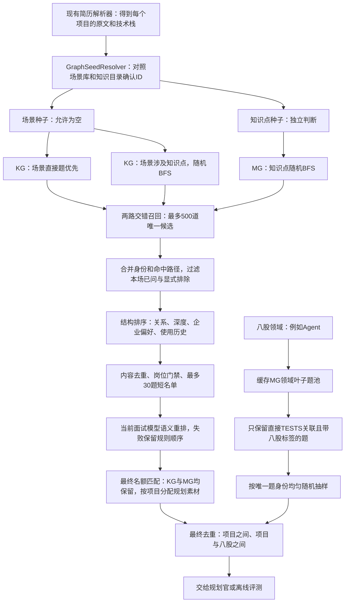

# MG/KG 纯图检索：架构与实现 v1

更新：2026-11-06。**已实现独立模块、模型端口适配和离线试跑入口，并接入面试创建主链路，默认启用图召回及当前模型语义重排，可用配置回滚。** 不调用向量或BM25，不实现TG，也不因检索修改草稿状态。

## 1. 架构图



| 代码 | 职责 |
| --- | --- |
| `backend/app/services/graph_seed_resolver.py` | 把单个简历项目映射为场景/知识点ID，保存原文引用 |
| `backend/app/services/graph_retrieval.py` | 图索引、项目双路BFS、配额选择、叶子八股抽题 |
| `backend/app/services/graph_retrieval_runtime.py` | 生产适配器：加载快照、解析项目种子、把图命中转换为规划官现有素材格式 |
| `backend/scripts/run_graph_retrieval.py` | 读取目录或已发布ZIP，运行多项目及八股并输出JSON |
| `backend/data/eval/graph_retrieval_v1/demo_query.json` | 可运行示例，种子为人工指定的演示输入，并非真实简历解析结果 |

## 2. 项目到两组种子

每个项目独立处理。现有PDF/简历解析器仍负责提取项目；新适配器消费项目的`name`、`role`、`tech_stack`、`highlights`、`description/desc`，不把模型生成的`dig_points`或旧`scene_tags`当作事实证据。

`GraphSeedResolver`通过已有`chat_json(system, user)`端口，让模型同时对照场景介绍、匹配/排除条件，以及知识点名称、定义、别名和父节点，分别选择场景与知识点。没有匹配场景时场景为空，知识点判断仍继续。只有原目录ID可以返回，不新建节点。

返回项必须包含原文逐字引用和解释。代码检查ID是否属于本次提供的目录、是否重复、是否超出上限以及引文是否真实存在于项目文本；这些是结构与引用检查，不能证明模型语义判断一定正确。

默认提供当前可用目录，不用字符串或关键词先裁掉知识点候选。active-only目录在当前图约6万字符，含草稿目录约46.5万字符；默认目录字符预算51.2万，超限明确报错而不静默截断。此上限是字符数，不是token预算，启用时还应按实际模型上下文和计费配置评估。后续大规模目录可另行设计分层定位，当前不冒充已经实现。

该适配器不会自行创建模型客户端或调用网络。命令行默认直接消费已经确认的种子，只有显式指定`--resolve-seeds`才使用配置的LLM。本文和测试中的示例没有调用真实模型。

## 3. MG/KG查询路径

图在存储上共享Concept和Question，不复制两套知识点。

| 查询路径 | 返回类型 |
| --- | --- |
| Scene → HAS_QUESTION → Question | 有标注依据的场景直接题 |
| Scene → INVOLVES → Concept → 下钻 → 反向TESTS | 场景知识扩展题，不能冒称该业务原题 |
| 简历Concept → 下钻 → 反向TESTS | 独立MG知识补充题，有场景时也必须执行 |

实际存储方向是`Question → TESTS → Concept`。查询通过入边索引查题，不为检索新增反向图边。

`HAS_SUBTOPIC`只向下；不从共享知识点反向进入其他场景，不爬到祖先再扫兄弟节点。题目是遍历终点。`REQUIRES`和`COVERS_TOPIC`在v1中不作为扩散路径。当前节点的直接题也会检查，因此项目检索允许取到非叶子节点上的题。

### 随机BFS和硬预算

- 知识点按层BFS展开：0层先于1层，1层先于2层；每个节点先发出一小批题，再扩展下一层。到达允许深度后，剩余候选预算回流给已访问节点的余下题，避免父节点的大题池阻止知识下钻。随机只改变同层访问和题目取样次序。
- 同层先按一级分支轮转，再在分支内按知识节点轮转，每轮最多发出5条命中，避免一个大分支先占满候选。
- 场景的直接题优先于该场景的知识扩展，但MG路始终与KG路交错执行。
- 深度从知识种子算起，场景→知识点和知识点→题目不占下钻层数。
- 同一知识点跨路可保留各自路径；全局唯一展开知识点预算共享，不因访问第二条路就重新获得200个名额。
- 达到预算就停止。题不足可少返回，不能为了凑数增大范围或放宽标签。

| 参数 | 默认值 | 含义 |
| --- | ---: | --- |
| `kg_candidate_limit` / `mg_candidate_limit` | 300 / 200 | 新增唯一题的初始通道名额 |
| `final_limit` | 100 | 最终项目参考题池上限，不是整场实际提问数 |
| `kg_final_quota` / `mg_final_quota` | 60 / 40 | 最终名额权重；修改final_limit时按比例分配 |
| `max_depth` | 2 | 知识点下钻层数 |
| `max_scene_seeds` | 2 | 单项目场景种子上限 |
| `max_concept_seeds` | 6 | 每路知识入口上限，包括KG的INVOLVES入口 |
| `max_children_per_node` | 6 | 单节点最多随机展开几个子节点 |
| `max_nodes_per_branch` | 20 | 一个种子的第一层子分支及其后代最多访问多少知识点 |
| `max_concept_nodes` | 200 | KG/MG共享的唯一知识点展开上限 |
| `questions_per_turn` | 5 | 每个分支/通道每轮处理命中条数 |
| `max_question_checks` | 10000 | 包括重复/被过滤命中在内的检查上限，防止无限补取 |
| `min_scene_direct` | 1 | 有适用场景直接题时，最终至少保留的数量 |

第一版用深度、每支节点数和总量共同限流，不额外固定“每支永远只能50题”。分支轮转使各支先拿到一批，耗尽分支退出轮转；剩余通道名额随之被其他分支使用。两路也使用同样的回流机制。某路为空、耗尽，或命中大量重复题时，允许另一条仍有新题的路补齐总预算。

## 4. 去重、过滤、排序和名额匹配

**边取边去重。** 同一题ID或显式确认的`canonical_question_id`重复命中，只占一个候选名额，合并命中通道与合法路径，然后继续补取新题。可通过GraphIndex的`duplicate_ids`提供外部已确认重复簇。时间戳不参与题目身份判断。

当前快照还没有完成跨来源全量语义去重。本实现不会把两道不同上下文的“日志怎么做的？”仅凭题干相同就合并；不同ID的语义近重复若没有已确认映射，仍可能同时返回。不能把500个不同ID称为500个已经证明语义不重复的题。

**硬过滤：** 本场已问ID/已确认重复簇、调用方显式排除ID、调用方明确提供的已问题干，以及标记`disabled/withdrawn`的题。模型领域适用性尚未单独精排，不能把此模块的结构分当作语义相关性证明；岗位、语言等业务权限/适用性策略应由后续接入层明确处理。

**结构排序：** 直接场景题基础分100，知识题基础分80，每下钻一层减7；双路命中加4，目标企业匹配加8。企业只加分，不排除其他企业题。多个路径不会重复叠加分数。这里是透明的初始规则，不是训练过或评测过的语义reranker；`focus`只保留在QuerySpec中作查询意图，不用于偷偷做文本召回。

**历史使用：** 通过用户/会话传入`history[question_id]`，不修改共享图：

```json
{
  "question:...:S0001": {
    "last_asked_at": "2026-11-05T14:00:00+08:00",
    "last_selected_at": "2026-11-05T13:59:00+08:00"
  }
}
```

最近提问最多降权45%，最近选入题单最多降权20%，7天线性恢复。仅被召回、不曾选用的`last_recalled_at`不降权。本场必须排除的题使用`asked_question_ids`，不靠时间惩罚代替。带时区的ISO时间或Unix秒有效；无时区时间不作猜测。生产数据库持久化尚未接入，本模块只消费传入历史。

**名额选择：** 每道题只归属一个最终名额。使用两路名额匹配，允许把同时命中KG和MG的题移到另一条可用名额，为单路题腾出位置；不能用一题同时满足两个配额。有场景直接题时先保证最低数量，KG/MG其他名额仍各自保留；只有题不足才回流。最终输出按结构分排序，并记录`assigned_lane`。

## 5. 八股：领域内真实叶子直接题池

```text
指定领域Concept
  → 预计算/缓存可达的叶子知识点
  → 只找这些叶子直接TESTS的题
  → 只保留category=bagu或显式bagu/八股标签
  → 按题目身份去重、排除已问和项目已选题
  → 无放回均匀随机抽样
```

叶子指完整图结构里没有HAS_SUBTOPIC子节点；过滤草稿边后看似没有子节点的父节点，仍不是叶子。项目检索可以取父节点题，八股在本轮规则下只取真实叶子直接题，不自动回退到父节点。

领域叶子及题池在GraphIndex中按领域集合缓存，后续抽样不重新执行项目BFS。一题挂多个叶子也只有一份抽样身份，不按挂载数增加概率。八股保持随机抽样，不因企业不同直接过滤；企业偏好排序目前只作用于项目参考题。

命令行按项目顺序把已选身份传给下一项目，再把全部项目已选身份传给八股，避免整场跨部分重复；题不够就少返回。

## 6. 运行方式

在仓库根目录执行，不需要额外安装数据库、图服务或模型依赖：

```bash
python3 backend/scripts/run_graph_retrieval.py \
  --input backend/data/eval/graph_retrieval_v1/demo_query.json \
  --out /tmp/deepask-graph-retrieval.json \
  --seed 42
```

默认直接读取已经发布的`docs/graph-demo/mgkg-9000-v3.zip`，也支持`--graph <解压目录>`。只读取ZIP的nodes/edges成员，不向任意文件路径解压。`--out`必须是新文件，避免覆盖历史试跑。

- `--include-drafts`：离线对照时允许草稿节点和边；默认排除草稿，图状态不会改变。
- `--include-candidates`：输出完整候选池与路径，默认只输出最终题池及统计。
- `--include-answers`：在输出中附带原参考答案；默认省略长答案，不影响召回。
- `--resolve-seeds`：对未提供种子的原始项目显式调用配置的LLM；这是可计费调用，默认不开启。不要把测试中的假模型结果当成真实模型效果。

原始项目输入可以使用：

```json
{
  "projects": [{
    "project_id": "p1",
    "project": {
      "name": "商户点评系统",
      "tech_stack": ["Redis"],
      "highlights": ["开发商户点评与到店优惠券核销，使用缓存展示商户信息"]
    }
  }],
  "bagu": {"domain_concept_ids": ["concept:redis"], "count": 5}
}
```

对应执行时加`--resolve-seeds`。已确定种子的离线实验则显式提供`scene_ids`与`concept_ids`两个数组，不调用模型。

## 7. 验证与当前边界

```bash
python3 -m unittest discover -s backend/tests -p 'test_graph*.py'
python3 -m unittest discover -s backend/tests -p test_run_graph_retrieval.py
```

图检索、种子、CLI与生产适配器测试通过，覆盖双路均执行、父节点题池不阻断下钻、无场景回流、重复补取、BFS层序、深度和分支/全局预算、路径来源、固定seed、配额重分配、企业排序、带时区历史、叶子结构、八股标签、模型ID与引文约束以及CLI整场去重。没有在测试中调用付费模型。

当前真实快照的试跑结果见[试跑记录](MG-KG图检索试跑记录-2026-11-06.md)。它只证明程序能读取现图、执行边界和输出数量，不是人工相关性测评或线上性能承诺。

生产接入：`GRAPH_RETRIEVAL_ENABLED`、`GRAPH_RERANK_ENABLED`默认均为`true`。A路岗位检索保持不变；项目B路采用图种子解析→KG/MG双路召回→确定性内容去重→岗位门禁→最多30题短名单→当前面试模型语义重排→最终配额选择。最终素材按项目分摊并轮转输出，项目编链复用同一批素材，不再另跑旧标签项目检索。重排必须返回短名单ID的完整排列，失败回退规则顺序；快照或种子解析失败回退旧B路。

图项目有可用知识点种子时，八股候选从其最高技术祖先限定的MG真实叶子题池随机取，保留岗位门禁并排除项目已选身份。八股的领域范围与项目BFS分开；没有可用图种子时保留旧八股召回。TG第一版已接入：从场景/MG锚点有限正向召回追问节点，真实采用后记录命中和相邻有向边；运行路径、种子证据和分阶段真实耗时保存在会话`retrieval_diagnostics`，不修改共享图或草稿。

设置`GRAPH_RETRIEVAL_ENABLED=false`回到旧项目检索；仅关闭`GRAPH_RERANK_ENABLED`则保留规则图排序。Docker Compose只读挂载仓库图ZIP，独立运行容器须自行挂载并设置`GRAPH_SNAPSHOT_PATH`。换图后重启后端刷新内存快照。

上线前仍需在真实部署模型上测逐请求延迟，并复测自动种子正确性。四组离线评测结论见[评测记录](MG-KG四组检索与LLM重排评测-2026-11-06.md)，生产接线与验证见[接入记录](MG-KG主链路接入记录-2026-11-06.md)。
